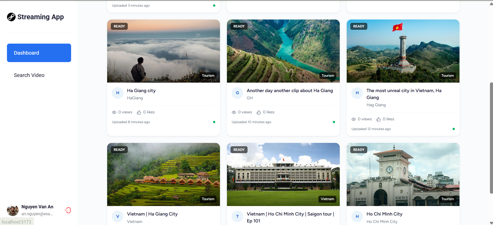
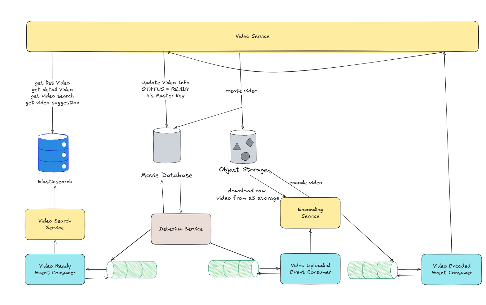
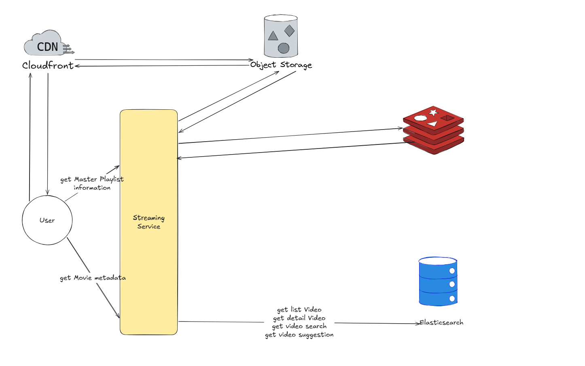

# cloud-streaming-system
Cloud Streaming System is a high-performance movie streaming platform designed to deliver seamless video playback and ultra-fast search capabilities. Built with a modern distributed architecture, this project leverages event-driven data processing and CQRS to ensure high scalability, low latency, and optimized data flow.

## 1. Highlight

### 1.1 Demo

### 1.2 Key features

- **Adaptive Bitrate Streaming**: Utilizes the HLS protocol integrated with a global Content Delivery Network (CDN) to dynamically adjust video quality based on network conditions, achieving a playback startup time of under 3 seconds.
- **CDC-Driven Search & Auto-Suggestion Pipeline**: Implements a real-time data synchronization pipeline using the CQRS pattern. Database changes are captured via CDC and streamed to the search engine, achieving an index synchronization time of under 2 seconds.
- **High-Throughput Search Engine**: Capable of processing up to 1000 queries per second (QPS) while maintaining a P95 search latency of under 100ms.

### 1.3 Tech stack:

| Category               | Technologies                                                    |
|------------------------|-----------------------------------------------------------------|
| Front End              | React                                                           |
| Back End               | Spring Boot                                                     |
| Database & Storage     | PostgreSQL (Metadata), Amazon S3 (Media Storage)                |
| Streaming & Delivery   | HLS (Adaptive Bitrate Streaming), Amazon Cloudfront (CDN)       |
| Data Pipeline & Search | Debezium (CDC), Apache Kafka, Elasticsearch (CQRS Architecture) |

## 2. Overall Architecture

### 2.1 Video Processing Architecture

### 2.2 Video Streaming Architecture

